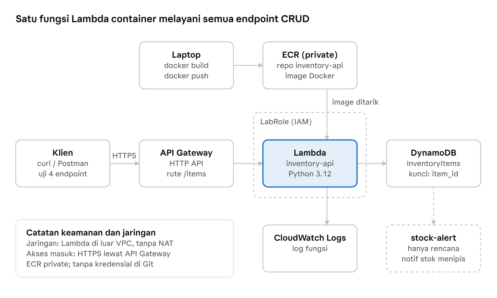

# Inventory API: layanan inventaris serverless di AWS

Proyek individu mata kuliah Komputasi Awan (Week 12: Desain & Setup AWS).
Author: `Rian Prasetya Munaji | 24/545573/TK/60702`



*Diagram di atas adalah arsitektur rancangan (API Gateway, Lambda container image dari ECR, DynamoDB). Di AWS Academy Cloud Foundations Sandbox, ketiga layanan itu tidak diizinkan sehingga diganti dengan alternatif yang memakai arsitektur yang sama; lihat bagian "Desain awal dan layanan pengganti".*

## Apa yang dibangun

Proyek ini adalah **layanan pencatat stok barang (inventaris) yang berjalan di AWS dan bisa diakses lewat internet**.
Pengguna atau program lain dapat menambah barang, melihat data barang, mengubah jumlah stok, dan menghapus barang
dengan mengirim permintaan HTTP ke alamat tertentu. Layanan ini berbentuk **API** (kumpulan alamat web beserta aturannya),
bukan aplikasi dengan tampilan, karena tujuan tugas ini adalah merancang arsitektur cloud dan membuktikan bahwa
infrastruktur awalnya berjalan.

Contoh: mengirim `POST /items` dengan isi `{"name": "Oscilloscope", "quantity": 3}` akan mencatat barang baru,
lalu `GET /items/{item_id}` mengembalikan data barang itu.

Layanan ini **serverless**: tidak ada server atau database yang harus dinyalakan terus-menerus. Kode hanya berjalan ketika
ada permintaan masuk, sehingga biayanya sangat kecil.

## Track yang dipilih

**Track C (Serverless)** dengan **elemen Track B (Docker)**. Dua layanan direncanakan:

| Layanan | Status | Fungsi |
| --- | --- | --- |
| `inventory-api` | Dibangun dan di-deploy | API CRUD untuk data barang |
| `stock-alert` | Hanya direncanakan | Memberi notifikasi saat `quantity` di bawah `min_stock` |

## Desain awal dan layanan pengganti

Lingkungan yang dipakai adalah **AWS Academy Cloud Foundations Sandbox** (region us-east-1). Tiga layanan dari desain awal
ternyata **tidak diizinkan** di sandbox ini (`AccessDeniedException` saat membuat resource), sehingga diganti dengan
alternatif yang tersedia. **Arsitekturnya tetap sama**: pintu masuk HTTPS → fungsi Lambda → penyimpanan data.

| Peran | Desain awal | Yang dipakai | Alasan |
| --- | --- | --- | --- |
| Pintu masuk HTTPS | API Gateway (HTTP API) | **Lambda Function URL** | `apigateway:POST` ditolak |
| Penyimpanan data | DynamoDB (`InventoryItems`) | **Amazon S3** (bucket `inventory-items-<account-id>`) | `dynamodb:CreateTable` ditolak |
| Registry image | ECR + Lambda container image | **Lambda paket zip**; image Docker di-build dan diuji di laptop | `ecr:CreateRepository` ditolak |

Kode mendukung kedua penyimpanan: Lambda memakai DynamoDB jika variabel `TABLE_NAME` diisi, dan S3 jika `BUCKET_NAME` diisi.
Di sandbox ini yang dipakai `BUCKET_NAME`. Bukti penolakan ada di `evidence/`.

## Peran tiap komponen

| Komponen | Peran dalam sistem |
| --- | --- |
| **Klien** (curl / `smoke-test.sh`) | Pihak yang mengirim permintaan ke API. |
| **Lambda Function URL** | Pintu masuk publik berbasis HTTPS milik Lambda (pengganti API Gateway). Meneruskan semua permintaan ke fungsi `inventory-api`. |
| **Lambda** (`inventory-api`, Python 3.12) | Menjalankan kode aplikasi: membaca metode dan path, memvalidasi isi permintaan, lalu membaca atau menulis data. Hanya aktif saat ada permintaan. |
| **Amazon S3** (bucket `inventory-items-<account-id>`) | Menyimpan data barang, satu objek JSON per barang: `items/<item_id>.json` (pengganti DynamoDB). |
| **IAM LabRole** | Peran yang sudah disediakan sandbox dan dipakai Lambda untuk mengakses S3 dan CloudWatch Logs. |
| **CloudWatch Logs** | Menyimpan log eksekusi fungsi untuk pengecekan dan pencarian error. |
| **Laptop (WSL: AWS CLI + Docker)** | Tempat tes unit dijalankan, paket zip dibuat dan di-deploy, serta Docker image di-build dan diuji secara lokal. |

## Cara kerja

**Alur permintaan (setiap kali API dipanggil):**

1. Klien mengirim permintaan HTTPS ke Lambda Function URL.
2. Function URL meneruskan permintaan ke fungsi Lambda `inventory-api` (format event payload 2.0).
3. Lambda memvalidasi data, lalu membaca atau menulis objek `items/<item_id>.json` di S3.
4. Hasil dalam format JSON dikembalikan ke klien.

**Alur deploy:**

1. Di laptop, folder `app/` dikemas menjadi zip lalu dibuat menjadi fungsi Lambda dengan LabRole sebagai peran eksekusi.
2. Function URL dibuat untuk fungsi itu dengan izin akses publik.
3. Docker image dibangun dari `Dockerfile` dan diuji jalan di laptop (elemen Track B), karena ECR tidak tersedia.

## Entitas data

Entitas `item`, kunci `item_id` (string, UUID).

| Field | Tipe | Keterangan |
| --- | --- | --- |
| `item_id` | string | dibuat otomatis oleh API |
| `name` | string | wajib, maksimal 100 karakter |
| `category` | string | opsional |
| `quantity` | integer | `>= 0`, default 0 |
| `location` | string | opsional |
| `min_stock` | integer | `>= 0`, default 0 |
| `updated_at` | string | waktu UTC format ISO 8601, diisi oleh API |

## Endpoint

| Operasi | Endpoint | Berhasil | Gagal |
| --- | --- | --- | --- |
| Create | `POST /items` | 201 + data barang | 400 (validasi) |
| Read | `GET /items/{item_id}` | 200 + data barang | 404 |
| Update | `PUT /items/{item_id}` | 200 + data barang | 400, 404 |
| Delete | `DELETE /items/{item_id}` | 200 `{"deleted": id}` | 404 |
| List (tambahan) | `GET /items` | 200 `{items, count}` | tidak ada |

Contoh pemanggilan:

```bash
curl -X POST "$API_URL/items" -H 'Content-Type: application/json' \
  -d '{"name":"Oscilloscope","category":"Peralatan lab","quantity":3,"location":"Lab 2","min_stock":1}'
```

## Hasil uji di AWS

Uji dengan `scripts/smoke-test.sh` terhadap Function URL yang sudah di-deploy (output lengkap di `evidence/smoke-test.txt`):

| Langkah | Status yang diharapkan | Hasil |
| --- | --- | --- |
| `POST /items` | 201 | 201 |
| `GET /items/{item_id}` | 200 | 200 |
| `PUT /items/{item_id}` | 200 | 200 |
| `GET /items` | 200 | 200 |
| `DELETE /items/{item_id}` | 200 | 200 |
| `GET` setelah dihapus | 404 | 404 |
| `POST` tanpa `name` | 400 | 400 |

Catatan: sandbox menghapus semua resource di akhir setiap sesi, sehingga URL API tidak aktif lagi setelah sesi berakhir.
Screenshot dan output di `evidence/` adalah bukti bahwa sistem berjalan.

## Keamanan dan IAM

- Lambda memakai **LabRole**, peran yang sudah disediakan sandbox (peran IAM baru tidak bisa dibuat).
- Akses hanya lewat HTTPS melalui Function URL. Pada tahap ini belum ada autentikasi (auth type `NONE`); autentikasi (misalnya `AWS_IAM` atau API key di API Gateway) adalah pengembangan berikutnya.
- Bucket S3 tidak dibuka untuk publik; hanya Lambda (lewat LabRole) yang membaca dan menulisnya.
- Tidak ada kredensial yang disimpan di repo ini (lihat `.gitignore`).
- Lambda tidak ditempatkan di dalam VPC, sehingga tidak butuh NAT Gateway.
- Input divalidasi: nama wajib diisi, `quantity` dan `min_stock` harus bilangan bulat tidak negatif, teks dibatasi panjangnya.

## Struktur repositori

```
app/handler.py            Handler Lambda: routing, validasi, respons
app/repository.py         Akses penyimpanan: DynamoRepository dan S3Repository
tests/                    Unit test (tanpa AWS), 38 tes
Dockerfile                Image Lambda (base image python:3.12), elemen Track B
docs/design-brief.md      Design brief
docs/deployment-plan.md   Langkah deploy yang dijalankan dan daftar bukti
docs/architecture.png     Diagram arsitektur
scripts/smoke-test.sh     Menguji endpoint yang sudah di-deploy
events/                   Contoh event Lambda
evidence/                 Screenshot dan output tes dari AWS
```

## Menjalankan tes secara lokal

```bash
python3 -m unittest discover -s tests -t . -v
```

Tes memakai penyimpanan tiruan (dalam memori, DynamoDB tiruan, S3 tiruan), jadi tidak butuh AWS maupun boto3.

## Deploy

Langkah lengkap yang dijalankan ada di [docs/deployment-plan.md](docs/deployment-plan.md). Ringkasannya:

1. Buat bucket S3 `inventory-items-<account-id>`.
2. Kemas `app/` menjadi zip dan buat fungsi Lambda `inventory-api` dengan LabRole dan `BUCKET_NAME`.
3. Buat Lambda Function URL beserta izin aksesnya.
4. Uji dengan `scripts/smoke-test.sh`.
5. Build Docker image dan uji jalan secara lokal.

## Catatan budget

Lambda, Function URL, dan S3 berbayar per pemakaian, dan sandbox menghapus semua resource di akhir sesi.
Tidak ada EC2, RDS, load balancer, atau NAT Gateway, sehingga tidak ada biaya yang berjalan saat sistem tidak dipakai.

## Status

- [x] Desain dan diagram arsitektur
- [x] Kode awal dan unit test (38 tes lulus)
- [x] Resource AWS dibuat (S3, Lambda, Function URL)
- [x] Konektivitas terverifikasi (bukti di `evidence/`)
- [x] Docker image di-build dan diuji secara lokal